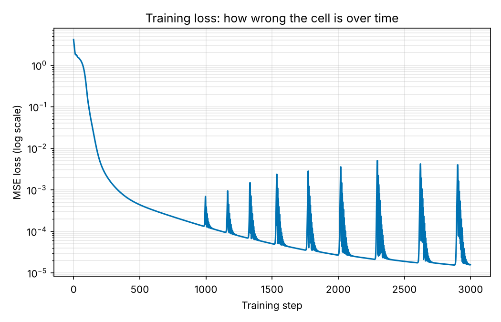
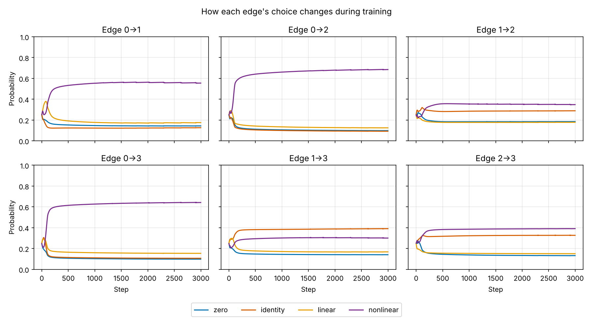
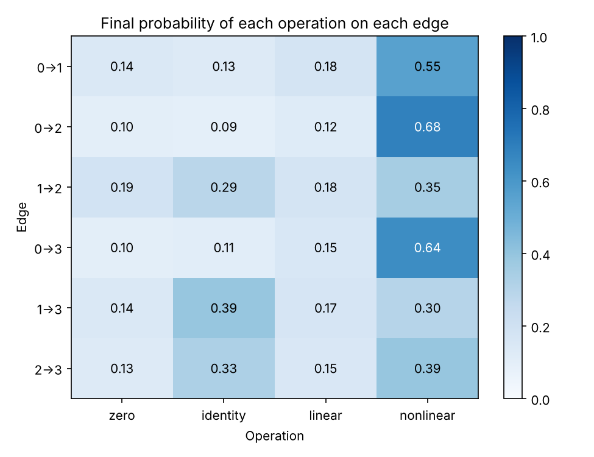
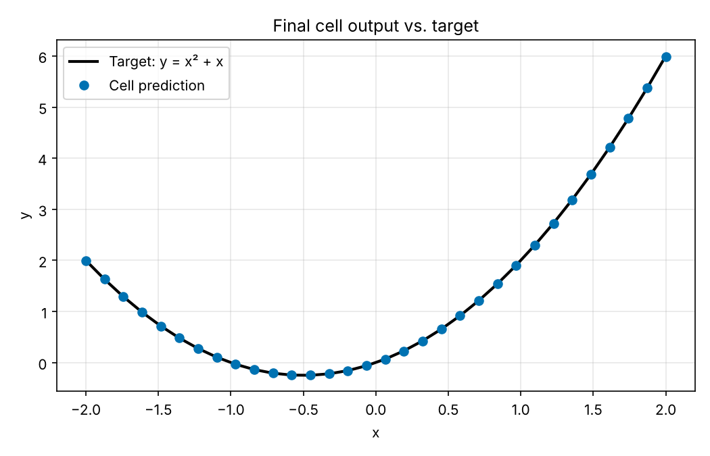
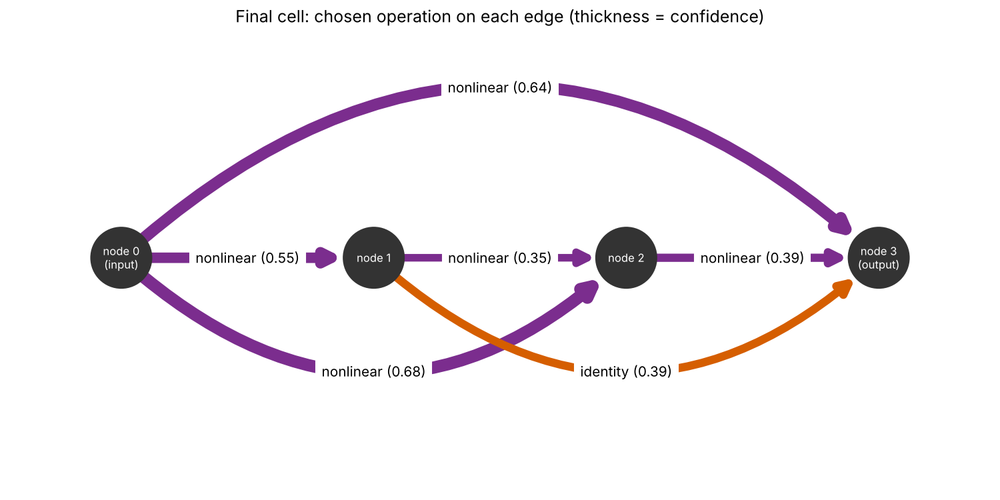

# PyTorch-Project
PyTorch repository of code related to ToF DARTS project

## Layout

| Path | What it is |
| --- | --- |
| `basics/linear_regression.py` | One `nn.Linear(1, 1)` trained with SGD to fit a single point. |
| `darts/01_single_edge_linear.py` | First DARTS toy: one edge choosing between Identity and Linear with softmax scores (SGD). |
| `darts/02_single_edge_mlp.py` | One edge choosing between Identity and a small MLP on 4 points (Adam), then picks the best op. |
| `darts/03_multi_edge.py` | A 4-node cell with 6 edges, each choosing among 4 operations, fit to y = x² + x. Saves the plots below. |
| `darts/figures/03_multi_edge/` | The five figures produced by `03_multi_edge.py`. |

The scripts in `darts/` are numbered in the order they build on each other.

## Running

```
pip install -r requirements.txt
python darts/01_single_edge_linear.py
python darts/03_multi_edge.py   # also writes darts/figures/03_multi_edge/*.png
```

## 03: Multi-edge DARTS

### Code overview

`darts/03_multi_edge.py` searches a small cell instead of a single edge.

- **Cell.** 4 nodes. Node 0 is the input, node 3 is the output, and every earlier node feeds every later node, giving 6 edges (0→1, 0→2, 1→2, 0→3, 1→3, 2→3). Each node is the sum of its incoming edges.
- **Candidate operations** (`make_operations`): `zero` (output 0, meaning "no edge"), `identity`, `linear` (`nn.Linear(1, 1)`) and `nonlinear` (a 1→16→1 MLP with Tanh). Every edge gets its own copy with its own weights.
- **Mixed edge** (`MixedEdge`): runs all 4 operations and returns their weighted sum. The weights are a softmax over 4 learnable architecture scores per edge (α in the DARTS paper), starting at 0, so every op starts at probability 0.25.
- **Training.** One Adam optimizer (lr 0.01) updates the operation weights and the architecture scores together on 32 points of y = x² + x, for 3000 steps, seed 0.
- **Result.** Each edge keeps the operation with the highest score. The script prints the probabilities every 1000 steps and the final choice per edge, then saves the figures.

Simplifications compared with the paper: weights and scores are trained together on the same data (the paper alternates, with scores trained on a validation split), the final pick is a plain argmax on every edge, and the chosen cell is not retrained.

### Figures

**1. Training loss** ([`1_loss.png`](darts/figures/03_multi_edge/1_loss.png))



MSE on a log scale. The loss falls from about 4 to 1.6e-5, mostly in the first 300 steps. The spikes after step 1000 come from Adam taking oversized steps once the gradients get very small, not from the architecture search: they remain when the scores are frozen and disappear with a learning rate of 0.001.

**2. Edge probabilities over training** ([`2_edge_probabilities.png`](darts/figures/03_multi_edge/2_edge_probabilities.png))



One panel per edge, one line per operation. All start at 0.25 and mostly settle within the first 200 steps. The three edges from the input clearly choose `nonlinear`; the three edges between intermediate nodes stay split between `nonlinear` and `identity`.

**3. Final probabilities** ([`3_final_heatmap.png`](darts/figures/03_multi_edge/3_final_heatmap.png))



The end of figure 2 as a table: rows are edges, columns are operations. A confident edge has one dark cell. `zero` and `linear` never win.

**4. Fit** ([`4_fit.png`](darts/figures/03_multi_edge/4_fit.png))



The trained cell's output against the target y = x² + x. This is the mixed cell (all operations weighted), not the discretized one.

**5. Chosen cell** ([`5_cell_graph.png`](darts/figures/03_multi_edge/5_cell_graph.png))



The architecture after taking the argmax on each edge. Colour is the operation, thickness and the number are its probability. Edges 1→2, 1→3 and 2→3 are close calls (0.35 vs 0.29, 0.39 vs 0.30, 0.39 vs 0.33), so those choices are weak and can change with the seed.
